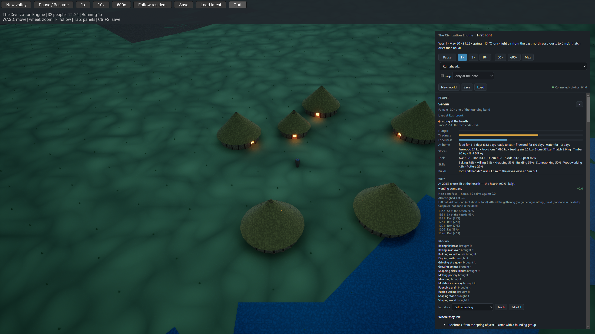
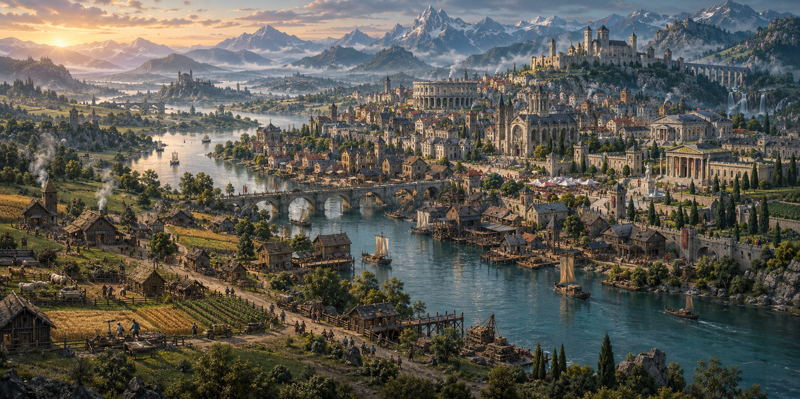

<p align="center">
  
</p>

<h1 align="center">The Civilization Engine</h1>

<p align="center"><strong>A living-world simulator where people build their own communities, economies and institutions.</strong></p>

<p align="center">People make a living, raise families, trade, learn, build and govern. Their choices shape the societies that emerge.</p>

<p align="center">
  <a href="#the-project">Project</a> · <a href="#project-status">Status</a> · <a href="demos/README.md">Demo gallery</a> · <a href="#technical-highlights">Technical highlights</a> · <a href="#run-it">Run it</a> · <a href="#documentation">Documentation</a>
</p>
<p align="center">
  <a href="#project-status"></a>
  <a href="#project-status"></a>
  <a href="#technical-highlights"></a>
  <a href="#technical-highlights"></a>
</p>

## The project

The Civilization Engine (TCE) is a long-running simulation of people, households and settlements. It provides resources, skills, institutions and physical systems; people make choices within them, so the engine does not prescribe a civilization's story or destination.

The current web observer presents an early farming world. M10 adds industrial systems and services; its money systems are underway. The [Windows Unreal observer](unreal/README.md) completes M2: runtime terrain, the first vernacular kit, visible construction, citizens, night lighting and embedded inspectors, in a standalone application. Modern civilization remains future work.

## Project status

| Status | Milestone | Overview |
| --- | --- | --- |
|  **Complete** | M0–M9 kernel/web | Settlement life, institutions, cities and many-settlement simulation. |
|  **Complete** | M10a–M10c | Industry, transport, services and public health. |
|  **In progress** | M10d | Money and counterfeiting are implemented; the M10 observer demo remains in progress. |
|  **Complete** | M2 Unreal client | Shared DLL bridge, editable tiled terrain with collision and PCG, Nanite vernacular kit, construction stages/scaffolds, crowd v0, day/night, inspectors and packaged Win64 build. The 16.78 km² terrain and running night village pass the 1440p60 gate. |
|  **Planned** | Future scope | Modern-era systems. |

Non-benchmark homelab simulations can now publish their actual world to the private runner
observatory: sampled terrain/water, settlements, buildings and people, with separate streams
for parallel worlds. This read-only export is opt-in and leaves the engine's save and command
protocols unchanged. See [live world observations](docs/operations/live-world-observations.md).

See the [project plan](PROJECT_PLAN.md) and [development journal](docs/development-journal/README.md) for milestone details and implementation evidence.

The [M2 capture and acceptance record](demos/m2/README.md) distinguish the lived village,
the diagnostic terrain-edit replay, and the earlier integration image.

## Latest live demo: M2, first light in Unreal

The newest capture returns to the Unreal track: 32 founders live for 90 days, build their
homes from the kernel's grammar, and gather by fuel-lit hearths. The standalone client follows
a resident and shows their existing inspector. This is the first kit and crowd v0; later city
styles and close-up characters remain future rendering work. The earlier M9 video shows the
more advanced many-settlement simulation. M10 has a runnable example and report workflow,
while its complete observer demo remains in progress.

<p align="center"><a href="demos/m2/m2-first-light.mp4"></a></p>

[Watch the M2 demo](demos/m2/m2-first-light.mp4) · [M2 measurements and reproduction](demos/m2/README.md) · [Earlier M9 demo](demos/m9/m9-overview.mp4) · [All demo versions](demos/README.md)

These generated previews show the project's longer-term historical and modern scope. They are concept art, not screenshots of implemented features.

<p align="center">
  
  
</p>

## Technical highlights

- **Kernel and observer:** Rust simulation workspace; TypeScript and PixiJS web observer; versioned FlatBuffers boundary and portable C interface.
- **Emergent simulation:** event-scheduled people and household economies, authored building grammars, institutions, weather, water, disease, conflict and transport.
- **Many-settlement scale:** each person remains individually represented; settlements away from the observer's focus can resolve household work once per day.
- **Industrial systems:** river-powered installations drive recipes; households can build mills, mines and works, lay rail, operate trains, and produce and distribute gas light.
- **Persistence:** checksummed versioned snapshots with explicit migrations. Current boundaries: wire 1.107, save schema 219 and content API 200.

## Run it

Install the pinned Rust toolchain and Node.js 22, then launch from the repository root:

```sh
./tools/run.sh          # macOS and Linux
```

On Windows, run `tools\run.ps1` in PowerShell. The observer opens at <http://127.0.0.1:7420/>. See [AGENTS.md](AGENTS.md) for development commands and change requirements.

## Documentation

- [Project plan and milestone status](PROJECT_PLAN.md)
- [Development journal and technical guides](docs/development-journal/README.md)
- [Demo gallery across milestones](demos/README.md)
- [Architecture decision records](decisions/README.md)
- [Research index](research/README.md)
- [Content authoring guide](content/README.md)
- [Web observer guide](web/README.md)

## License

No license has been added. Until one is chosen, the repository does not grant reuse or redistribution rights.

## CI runner pool

Dedicated Linux VMs on servernode1 and servernode3, with optional capacity on servernode4, provide the [GitHub Actions runner pool](docs/operations/github-runners.md). Automatic routing prefers idle node4, then node3 and node1; jobs budgeted above six hours exclude node4, and timing benchmarks stay on node3. Windows and pull-request checks retain GitHub-hosted runners. The runner guide covers candidate branches, routing, isolation, and safely stopping the optional runner before switching servernode4 to Windows.
