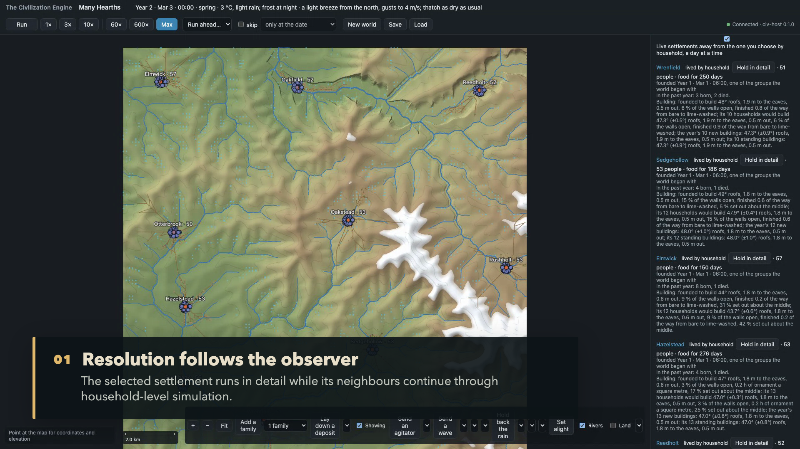

<p align="center">
  
</p>

<h1 align="center">The Civilization Engine</h1>

<p align="center"><strong>A living-world simulator where people build their own communities, economies and institutions.</strong></p>

<p align="center">People make a living, raise families, trade, learn, build and govern. Their choices shape the societies that emerge.</p>

<p align="center">
  <a href="#the-project">Project</a> · <a href="#project-status">Status</a> · <a href="demos/README.md">Demo gallery</a> · <a href="#technical-highlights">Technical highlights</a> · <a href="#run-it">Run it</a> · <a href="#documentation">Documentation</a>
</p>
<p align="center">
  <a href="#project-status"></a>
  <a href="#project-status"></a>
  <a href="#technical-highlights"></a>
  <a href="#technical-highlights"></a>
</p>

The Civilization Engine (TCE) is a long-running simulation project. It models people, households and settlements from the ground up: how they find food, learn skills, build, trade, make rules and respond to events. The engine supplies the materials and social mechanisms; it does not script a civilization's story or destination.

The current playable world is an early farming society. The project roadmap reaches industrial and modern civilization, but those systems are still being built. The Unreal client is also future work.

## Project status

| Area | Status |
| --- | --- |
| M0–M1 · World and village life | Implemented |
| M2 · Unreal client | The portable Rust kernel and C interface are available; Unreal integration remains future work. |
| M3a–M3c · Economy, knowledge, buildings, weather and soils | Implemented |
| M4 · Councils, law, crime and political change | Implemented. The latest fifty-year dashboard still has a failed food-price row in one world; see the project plan for the result and limits. |
| M5a · Neighboring settlements | Implemented: contact, visits, marriage, migration and coalition founding. The 3,000-person, three-settlement run takes about 19.6 minutes at Max; the ten-minute design budget is not met. |
| M5b · Trade and diffusion | Implemented: households trade using dated reports, fetch goods to resell, and learn techniques and building styles through contact. The earlier roof-style demo no longer qualifies after corrected river routing separated its villages. |
| M5c · Inter-polity relations and public works | Implemented: claims, agreements ratified by each settlement's own law, carried payments, and household and village log crossings. A failed ratification appears in a test world, not a lived demo. |
| M6a · Water and sickness | Implemented: flowing water, aquifers, springs and household wells; waterborne contamination and disease; illness, care, suspicion, source avoidance and collective responses. The cholera demo traces an outbreak that people do not connect to the wells that carried it. |
| M6b · Fire, masonry and floods | Done (its open items close this entry): buildings burn and spread fire; people notice, raise alarms, carry water, strip threatened roofs and salvage goods; those latter choices remain available without a known water route. The dashboard has a Fires row for household escapes and a preliminary ungraded Floods and storms row; its exposure accounting remains partial. Masonry, brick and tile, flood depths and wet-floor damage, evacuation, storm uplift and flood/storm kernel commands are implemented. River overrides hold their requested days and route added flow downstream; forced storms change today's wind. Hazard origins and one uplift evaluation per covering per storm are saved. Flood exposure and floor loss advance daily; household supplies return to the chosen flood refuge. The chronicle sums household fire escapes monthly. An equipped crew can pull down an empty threatened building with ownership or leave on site; partial work saves. People tell dated accounts of buildings found burning through ordinary contact, without asserting a cause. Fire pages add dated notices and response work with physical reasons. Task awareness follows personal records and connected physical fire scenes. The Help at a fire lens separates one current availability probe from thirty days of recorded work. The 1–100/K household-year ignition sweep is measured and published; the Fires row separates observer-caused losses. Crew coordination and response calibration remain partial. BG begins with saved sub-grid bank crests, explicit borrow-earth accounting and conservative river-flood barriers, shown as lines in the observer. Ground beneath banks and borrow pits enters flood storage, including after a breach. Actual overtopping lowers bank crests and retains washed earth as sediment stock. Households remember what floods cost them; a gathering can pass a flood bank where it would have kept that water out, and people choose to dig, carry and place its earth in equal shares (one-segment banks on free ground only). Banks settle; water held against one side seeps through and can break them, and a broken bank is told in the chronicle. A gathering can pass a law to keep a bank it built, which asks the households to mend it after floods and each year; nobody mends a bank no law keeps. A household whose crop went short of water can dig an irrigation ditch to its field from the river and open it in dry spells; its water is debited from the river below and every loss is accounted for, and the map draws it. Households remember fires they lost a building to or saw; once someone knows how to fire tile, a gathering can pass a rule that new roofs near other buildings must not burn, which builders keep with tile or a plot apart, or break. Households also hear of buildings that give way; a gathering can ask that new walls be of stone or brick, or that new buildings stand apart. The M6b demo sets a fire in a village that had none of its own: it takes three huts, and the gathering passes walls of stone and a gap between buildings within two weeks, which bind nothing in the year after because the huts are mended rather than rebuilt. Left open: trapped rain, shared ditches, multi-segment banks, crossing scour and flood gates. |
| M6c · War and conquest | Implemented: households take from homes of other villages they have seen; bands are called, joined, mustered and walked to a household, where a two-sided encounter by the minute decides who gives way and what is carried off; a gathering may send a band by law, raise a palisade with gates kept shut, hear raids its own people made, seek terms with a word not to raid, take a village its band holds into one polity, and lose it again to a revolt there. The Government panel shows each polity's settlements and a siege page with each side's food at current use. In the lived demo two villages of 100 raided each other for a year and a half; Heronfield raised a palisade, made a law against raiding, took its custom to its elders and sent bands by law until one held Willowbank (two priors nudged, logged). Neither gathering took the held village in. |
| M7 · Politics deepens | Implemented (M7a, councils and elections; M7b, courts and precedent; M7c, trade laws and organizations; M7d, credit and money): offices may be held for a term and filled by lot from those who stood for them; a village may amend its custom to a council of 5 or 9 seats filled by election or by lot, whose election is called, told, stood for, polled at the hearth and counted by the block vote, every failure recorded; the council alone is the body then, and the label reads it as a republic. Those who stand say where they stand and campaign at the hearth; voters weigh distance, record and their faction's slate; a polity of several settlements may share its seats among them; factions that would lose apart may agree one slate. The M7a demo's village nudged one prior and took a council of 5 by 65 to 0, eight standing for its seats ([ADR-0024](decisions/0024-seats-offices-and-elections.md)). A law may name a forum to hear cases (one hearer, a panel by lot or the elders), whose findings are remembered and told and lean later sittings as its authority says; a limit adopted through the custom's amendment route forbids laws that keep people from daylight work or levy too much, and a forum given review may strike a breaching law down when someone it burdens challenges it; a ruling is known person by person, and what a forum finds is held against the forum ([ADR-0025](decisions/0025-forums-precedent-and-review.md)). M7c ([ADR-0026](decisions/0026-organizations-privileges-and-trade-policy.md)): a polity may lay a duty on tools its people buy at another settlement's door, paid to its store or kept back, or an embargo on a settlement's doors, kept or broken person by person. Those who sell the goods a duty would serve may organize, by rules of who is admitted and who decides; those turned away hold it against the organization, and a polity may recognize one, sparing its members its duties on those goods. A recognized organization may be granted a licence or a staple: others keep it or break it at their doors, its members bring breaches as cases, and a workshop that keeps it and sells nothing is given up as barred. A store's keeper may draw from it for their own household and, when it runs low, answer those they favour; a duty's collector may ask a buyer for a payment to assess nothing; a sponsor whose law would fail may give food to households it would bring round, who owe them for it at the gathering. A custom may be amended to close the gathering to members of recognized or privileged organizations, and the government panel says in sentences what an organization has come to hold. The M7c demo's villages passed an embargo and a duty on tools once a neighbour's door was used, but nobody organized: at this scale trade is too small to fight over. M7d ([ADR-0027](decisions/0027-claims-and-coin.md)): a household short of food before its harvest may borrow grain from a neighbour with food to spare, who weighs the loan by what it believes of the borrower and asks an increment; the loan is repaid after the harvest or, unpaid, defaulted and remembered. A lender that would refuse may lend against the use of a field or with a guarantor; at the due day a debtor pays, asks for time or refuses, and a failed loan's pledge is taken. A workshop short of a wage owes it and fails only if it is still unpaid when due. A village may pass a law of *debts heard*: a creditor then brings a loan left unpaid before the gathering, whose finding gives the debtor time or imposes what is owed. A village may also lend from its common store, at its law's terms, to households short before their harvest. Custody waits: no village household ever held more than its roof kept. Copper is content: ore on uplands, smelting found by those who fire kilns (or taught by the observer), and a cast copper axe that does an axe's work and lasts three times as long, made when it costs a household fewer hours for each hour of use. Copper is paid by weight, worth to its holder what it last bought, less beyond a few weeks' spending. Coin can be held issue by issue in purses, and a village may name a mint's keeper, to whom households bring copper for coin less a fee, when coin is worth more to them than its metal, its store may pay coin for the hours households give to its common works, and its levy may be paid in coin, which makes a piece worth the grain it pays for. Those who know smelting value coin by its copper and pay with the lightest; a village may strike lighter coin; another village's coin is taken by weight at a discount; the chronicle records a mint's first coin and the wealth panel tells each village's coin. The M7d demo's villages lent and borrowed grain within their first year without a nudge (84 loans over two seeds, 54 from common stores), but in four years nobody smelted copper: the village taught to smelt still held about 19 stone axes and never needed a new one, so no mint or coin arose. |
| M8 · The growing city (v1) | Done ([ADR-0028](decisions/0028-scale-and-the-m8-gate.md), [ADR-0029](decisions/0029-ways-modes-and-traffic.md), [ADR-0030](decisions/0030-planning-and-land.md)), in four parts: M8a scale, M8b ways, modes and traffic, M8c planning and land, M8d buildings and earthquakes with the demo. **M8a is done:** exact speed work (settlement indexes, who heard what, company at the hearth, the route cache), views let go only for those a transfer concerns, and Max lived in chunks so the host answers within half a second at 10,000 people. Three settlements of 3,334 live a day in about 21 s on the container, some 130× from the gate of a simulated year a real minute; the gate is measured at M8's end and amended to the figure reached (ADR-0028 §1). **M8b is done:** ways as records once worked, the dugout and the handcart (no beasts yet), queues only at bottlenecks, goods in transit, and works on ways by law. **Slice CM is done:** ways as saved records with widths, a keeper, kept wear and a derived rank, read by the observer's Ways layer (saves 140, wire 1.84). **Slice CN is done:** walkers take turns at crossings and gates, a wait of a minute or more re-times their walk and is remembered, and the Traffic lens and wait incidents show where and when people wait (saves 141, wire 1.85). **Slice CO's three parts are built:** the river for boats (navigability by the day's stage, directed speeds, the quickest way by water), the dugout as a record of its own, errands by boat that weigh the whole chain against walking and carry their load home in transit, and households that make a dugout when it would save them more than it takes (saves 144, content API 134); ferrying, fishing and owed goods by boat wait. **Slice CP has five parts built:** where wheels go (ways and worn trails wide enough, decks but never a log) and how hard a loaded cart is to pull there, by the pull a grade takes (content API 135); the core's handcart, errands by cart weighed against walking and boating, pulled there and back by someone of the household with the load in transit until unloaded (saves 145); wheels on an axle, a far technique the handcart needs, with households that know it making a cart at the door from their timber when it would save them more than it takes (saves 146, content API 136); and carts meeting by clearance, waiting at the near end of a stretch too narrow for two or turning back at their own door (saves 147); and the observer's view of boats and carts, where each stands or who has it out and what is aboard (wire 1.86). **Slice CQ has four parts built:** households remember, where each happens, the hours their carts lose on climbs and at stretches too narrow for two (saves 148); and a household whose carts keep waiting at such a stretch clears a passing place at its middle when the waiting it would spare outweighs the work (saves 149, content API 137). **CQ's third part is built:** where the settlement's waits together would repay one, its gathering may have the polity clear a passing place by law, each household asked an equal share of the work (saves 150, content API 138). **CQ's fourth part is built:** a household whose carts drag on worn trail near home lays a way of cleared ground over it when the hauling it would spare outweighs the clearing (saves 151); the slice is closed, its other works deferred. **CR's two parts are built:** its first, travel is measured, each resident's day by what their household lives by, trips by purpose and mode, and waits, on the dashboard's Travel row (saves 152); its second, where to live weighs the walk: a household's residence review counts the minutes a day its members travel against what people of each place it knows travel (saves 153, content API 139). Ferrying, fishing, widening, landings, grading, upkeep by law and tolls are deferred with their reasons. **M8c is designed** ([ADR-0030](decisions/0030-planning-and-land.md)): where a household builds becomes a choice in hours whose receipt is the only land value, and the 300 s home reach gives way to it; a plan is a law that reserves ground and builds nothing; claims it touches are bent round, swapped, paid for or taken (never a standing home); a keeper allots parcels by need, lot, offer or standing; keeping a plan is each builder's choice and cases are brought; zoning is a plan's clause beside two nuisance rules; no land is sold in M8. **Slice CS's first part is built:** each person holds the places they walk to from home, fading, for the choice of where to build to weigh (saves 154). **Its second part is built:** a household about to build a home weighs plots about its old point and toward where its people go, in hours of walking over five years and levelling, takes the cheapest within the walk it accepts to a field, and the plot keeps the receipt; the 300 s reach no longer bounds it (saves 155, content API 140). **Its third part is built:** the building inspector says why a home stands where it does, from its plot's receipt (wire 1.87); slice CS is closed. **Slice CT's first two parts are built:** a pure function lays a plan's grid of streets, a square and parcels over the ground as it is, leaving out and counting what the ground refuses; and the plan law: a polity sees homes that find no ground, trails built over and homes beyond the built edge, someone who knows how to lay ground out by cord and stake lays the grid up to six ways, each household weighs each in hours, and the one put forward is kept as laid, versioned (saves 156, content API 141). **Its third part is built:** builders who keep a plan in force keep its streets and square open, and a building begun on them is counted against the law and recorded as an encroachment (saves 157). **Its fourth part is built:** the map draws each plan's reservation layers, the ground it reserves and its parcels, reserved ground a way already runs over, and buildings standing on reserved ground (wire 1.88); slice CT is closed. **Slice CU's first part is built:** a plan's sponsor keeps it and gives a household about to build the free parcel nearest the hearth, which it weighs in hours with the plots it finds; one built on keeps its parcel and the rule it was given by (saves 158). **Its second part is built:** a plan may instead give its parcels by lot, for a fee paid once to the store, or to households whose eldest its keeper regards (content API 142). **Its third part is built:** a parcel given by offer may ask a yearly ground rent in food, owed the store each year to the day and answered as a fine is (content API 143). **Its fourth part is built:** a plan may open its parcels in phases outward from where it is laid, each opening once most of those before it are given (content API 144). **Its fifth part is built:** a plan may take the fields under its ground or pay their holders, who may refuse; a reserved field begins no crop again and, once idle, keeps no ground (saves 159, content API 145). **Slice CV's first part is built:** a building begun on a plan's reserved ground is seen by those living near and the plan's keeper, one of whom may bring a case that a forum hears and, finding it, imposes the plan's sanction (saves 160, content API 146). **Its second part is built:** a plan's sanction may take the building down on the day what was imposed falls due, or let it stand for a yearly payment to the store (saves 161, content API 147). **Its third part is built:** whether a builder keeps a plan weighs the sanction it expects, from the findings under it they have heard of; slice CV is closed, its backlog row deferred to CX. **Slice CW's first part is built:** two nuisance rules a gathering may make, a home where fire is worked kept from others' homes and a new home and its midden kept from the wells, the first answer to sickness (content API 148). **Its second part is built:** a plan may keep a ring of its parcels for some uses, homes offered parcels only where homes are allowed; slice CW is closed (content API 149). **Slice CX's first part is built:** the dashboard's Land row reports each settlement's densities, ground paid for, plans' shares and backlog, and what plots were reckoned worth by walk to the hearth. **Its second part is built:** the map's Land toggle draws every plot as paid for, reckoned worth, or nothing recorded, and says which (wire 1.89). **Its third part measures the largest settlement M8 lives:** one of 10,000 lived its first 30 days at Max at a median of 40 s a day (1.64 GB), on 132 ha at 76 people a hectare; slice CX is closed, and with it **M8c**. **M8d is designed** ([ADR-0031](decisions/0031-tall-public-buildings-and-shaking.md)): frame grammar version 3 up to four storeys beside the frozen versions, techniques that open structural systems rather than raise caps, a lateral margin used only when the observer shakes the land (one evaluation per building, cracks kept, kept apart by origin), rules after a shaking, buildings a polity raises and owns for a measured loss, style over seven traits, and the M8 demo with the gate. **Slice CY is done:** why no frame is built, probed (nobody can come to know framing, and land never reaches what a household builds); and frame version 3 beside the frozen versions 1 and 2, with 32 parameters, up to 12 bays and four storeys, mass walls by storey, a stair, openings, a trussed roof, storeyed posts and wall ties, mass walls costed and checked by content's masonry figures (content API 150), and the inspector's words for each; builders still design under version 2. **Slice CZ has five parts built:** gravity checks for version 3 (walls' own weight, ties' restraint, storeyed posts, trusses and purlins); framing and the three structural systems found by building (content API 151); builders designing under version 3 with walls of masonry's own thickness; a home's shape weighed with its ground; and walls tied where tied masonry is known. **Slice DA's first two parts are built:** lateral margins (overturning, sliding with cohesion lost once cracked, posts as cantilevers), and the ground shaken in the kernel: one keyed response per standing building, failures as under load, cracks kept until mended, every event recorded (saves 162); and the observer's "Shake the ground" with the dashboard's Shaking row, kept out of structural failures (wire 1.90). **Its fifth part is built:** each building that fell or cracked when the ground shook is an incident with its page, each shaking is listed with its own page, and the chronicle's entries open it (wire 1.91). **Its sixth part closes it:** a shaking's collapses are kept out of the failures row, a crack holds through a save until the wall is mended, and twin villages shaken alike lose more where the walls are untied; slice DA is closed, the map's damage layer deferred. **Slice DB is done:** after a shaking a gathering may keep rubble and mud brick a storey high, or, once someone knows tied masonry, require walls above a storey to be tied; a household whose tall home fell forecasts the floor a height rule takes, builders who keep either build lower, and a building that gives way is remembered against every technique it used, so a fallen rubble wall thickens the next (saves 163, content API 152). **Slice DC's first two parts are built:** each polity measures a year its common store's spoiling, its gatherings held in the wet and fires that reached a roof (saves 164); and where its store spoils, someone who can frame a granary may ask the polity to raise one by the hearth, held in its own name, each household asked an equal share of the work, the finished storehouse keeping the common store under its roof (saves 165, content API 153). **Its third part's first half is built:** rain keeps people from a gathering held in the open, and the hours given to one it left without a quorum are measured; where they are, a gathering may raise a hall by the hearth, under whose roof rain takes nothing (saves 166, content API 154); **and its second half:** a fire nobody saw for ten minutes is measured by the work it cost, and where a watch keeps watch a gathering may raise a watch tower, where its round begins and from which a burning roof is seen 500 m off (saves 167, content API 155). **Its fourth part is built:** each building raised together keeps when it was proposed, laid out, last worked on, first used and finished, stands stalled after a season with no work, and those who use it see who gave their share, who built it, and whether its sponsor's counsel was borne out (saves 168, content API 156). **Its fifth part closes it:** the government panel reads each building raised together as a sentence, why and by whom, the hours given and by how many households, and whether it was finished or stalled (wire 1.92); slice DC is closed, patrons' shares deferred. **Slice DD is done:** frame version 3 lays out a front, ornament, finish and symmetry costing hours, its openings the fourth; taste moves over seven traits, a front only toward a building that has one, ornament and finish only toward one the household could build (saves 169, content API 157); a building is seen from farther the higher it stands over its neighbours, so a tower is an exemplar from twice as far; and the clocks speak of all seven. **Slice DE closes M8:** the demo (`demos/m8/m8-demo.txt`) lived two settlements of 500 three years with framing introduced by the observer; no household built a frame (a first home is the cheapest that houses it, a larger one waits on means none reached), the polities raised two granaries and a hall, both gatherings first rejected a plan of streets and the port passed one later, and a shaking at 0.4 felled nothing. The scale gate is amended to the figure reached: 10,000 people at 0.0031 simulated years a real minute (53.5 s a day) on the container, the demo's 1,000 at 0.049 (ADR-0028, amendment); the target PC is not yet measured. |
| M9 · Aggregate LOD & scale | Done ([ADR-0032](decisions/0032-resolution-per-settlement.md)), in three parts: M9a the household day, M9b many settlements, M9c skips, climate and the demo. Every person stays one record at every resolution; a settlement away from the observer's focus will have each household's day scored once at midnight by the same rules and applied through each behaviour's own effect. Time skips are kept, as fast runs; the gate is 100,000 people in ten or more settlements at 0.1 simulated years a real minute. **Slice DF is built:** which settlements are household-resolved is a run setting; at a midnight their people are parked at home without changing anyone, any holding or the books, and live only their needs until slice DG resolves their day's work; a save of such a world lives on exactly once the setting is made again. **Slice DG is built:** a household-resolved settlement now works: each member is scored once a day by the same rules and lives each chosen activity's share of the day through its own effects (fields, building, making, gathering, company at the hearth, buying and asking within the settlement); in a 2×500 run it kept pace with Detailed (291 fields against 293) at about a fifth of the cost. **Slice DH is built:** every behaviour is shared in a household-resolved day, never taken there (visits, fetches, bands, fighting fires), or lived apart (sleep, meals, water); gatherings, polls and petitions count their arrivals; a settlement is held Detailed while a fire burns or a band is out; visitors meet its parked people. **Slice DI's first part:** Gate C (`civ-host consistency --household`) holds the household day to Gate B's Detailed runs and tolerances; after four fixes found by it (night and meals counted, energy by activity, the night from turning in, three weighings a day) it is within a few points on every aggregate but still fails, so household resolution is not yet a default anywhere. **Slice DJ is built:** a world takes up to 30 founding groups; 100,000 people in ten settlements are founded, lived household-resolved and saved on the bench (2.4 GB at most; 3.4 to 6 minutes a simulated day, far from the 1.6 s the gate asks); a household now notes at most 150 others at a crowded water source, which had grown with the square of a settlement's size. **Slice DK's first part:** in a world of more than three settlements the observer may have those away from the one it chooses lived by household (off by default); the settlements list marks them and can hold any in detail. **Its second part:** someone of such a settlement is drawn where the block of their day the clock is in puts them (asleep at home, at work in their field, at a meal), and the inspector says when it ends; the person selected is followed, their settlement lived in detail from the next midnight. **Slice DL is built:** running ahead can be a skip, at the fastest speed with every settlement lived by household, stopping at the date, when the observer stops it, or at the first entry of a kind marked (a new settlement, hunger, a disaster, politics, a discovery), the speed and resolutions put back after. **Slice DM is built:** the observer can change the climate, warmer or cooler and wetter or drier, coming in over years or at once; snow, water, soils and harvests follow through the weather, and the change is saved and told in the chronicle and the weather panel. **Slice DN closes M9:** an exact cut to the polity's plan forecast; the gate measured at 100,000 people in ten settlements (224 s a simulated day, 0.0007 simulated years a real minute, 2.3 GB), about 140 times short of the figure asked, and amended to it with the profile naming the next levers; and the demo (`demos/m9/m9-demo.txt`): ten settlements, one person followed in full detail and the rest lived by household, the climate forced, a decade lived, everyone still one record. |
| M10 · Industrial content | Designed ([ADR-0033](decisions/0033-power-fuel-and-the-works.md), [ADR-0034](decisions/0034-rail-and-gas-light.md), [ADR-0035](decisions/0035-services-letters-and-notes.md)), in four parts: M10a power and the works (fuel by heat, iron, water power, coal, engines, factories), M10b rail and gas light, M10c services and letters (care, birth attendance, schooling, writing, inoculation, a health office), M10d money (acceptance, deposits, notes, runs, a polity's notes). Everything enters as vocabulary people may take up or not; a world where nobody knows the new techniques lives as before. **Slice DO is done:** route caches by reach, wear by mode. **Slice DP is done:** fuel by heat, batches that run unattended (charcoal), and iron from bog ore by the bloomery and forging under smithing, which founders do not bring. **Slice DQ is done:** a workshop's own stations (a kiln that stays with the works) and several lines with goods in progress. **Slice DR is done:** water power at a site (an installation's kilowatts from its river reach each day, P = ρgQHη), making that takes power, the water mill (content API 160); a household that grinds by hand and knows the mill sets one where a headrace along a reach near home leaves its wheel a fall, digs the race as a ditch and only then wants a wheel (saves 174); a household beside a working mill carries its grain there and pays a sixteenth for the grinding, and weighs its own mill against that toll (content API 161); and the map shows each mill and the power its river gives it today (wire 1.97). **Slice DS:** coal seams in the uplands (ids of their own, so no other id moves), burned at the hearth by its heat only by households that know how, which is found where coal is known to show (content API 162); coal pits dug below the water table fill and are bailed by hand before digging goes on (saves 175, content API 163); an atmospheric engine set at a pit pumps it each day with its owner's coal, by the work of the lift over its heat (saves 176); and a household that knows how to build one sets an engine where the hours it bails a pit by hand repay it and its fuel (saves 177). **Slice DS is done.** **Slice DT:** a machine names the crew it wants at it together and a missing hand idles it, and a works with one rings a bell at sunrise and hires for its shift, so its hands are there together; the first is a tilt hammer driven by a wheel (saves 178, content API 164); in a household-resolved settlement a crew is met in aggregate, the machine running for the day's hands together. A workshop's page shows its bell and shift, its machines with the crew each wants, and who is at work there now (wire 1.98). Coke is baked from coal, and a blast furnace of four hands blown by a wheel smelts pig iron on charcoal or coke, which the hammer fines to bar. A water wheel near a pit its holder dug pumps it, before any engine burns fuel there. **Slice DT is done.** **Slice DU has begun:** a lamp is vocabulary, a clay dish burning tallow for light (content API 165), which nobody yet finds or wants; a household holding one and its tallow may make at home after dark, burning 8 g an hour and wearing the lamp, with an escape hazard as a lit hearth's (content API 166); and once a world has lit a lamp, a taking after dark is seen from 10 m, or from day sight's 30 where a lamp lights the place (saves 179, content API 167); a household that knows lamps makes one when an hour lit costs it less than an hour of its work, and renders tallow to keep it burning; the clock counts homes lit and a person's page says who works by lamplight (wire 1.99). **Slice DU is done.** **Slice DV:** a wagon on timber rails and the knowledge of wooden railways are vocabulary (content API 168), and track can be laid by cells that turn at most 45° a cell and keep a ruling grade, though nobody lays any yet; a line begun is a way for wagons alone, its bed graded to its ruling grade by cut and fill, laid by its keeper's work and timber and carrying wagons once whole (saves 180, content API 169); a household's wagon on its line from a pit home brings what a session digs, up to what one person pushes up the line's steepest rise, rather than one person's carry (saves 181). A household that knows wagons and digs a pit often enough weighs a line from it home once a year, and begins the line and a wagon where the hours spared over the wagon's life repay them. The map draws each line by how much of it is laid, with its rails once whole, and each wagon where it stands; a line finished is chronicled (wire 1.100). **Slice DV is done.** **Slice DW:** a locomotive, an engine on rails that burns coal for its pull, is vocabulary nobody knows yet (content API 170); a train is timed along its line by its engine's power over its pull, and runs hold block sections between passing loops one at a time, waiting at the loop for the next (saves 182); a household's engine on its line from a pit takes what the digging loads onto its wagons home each morning, burning coal by its work (saves 183); a household with its line and wagons weighs an engine once it knows the locomotive, and begins one at the pit end where the hours spared beyond its coal repay its making, though with the core's wagon one person already pushes home all a session digs, so none yet does. The map draws an engine apart from its wagons, and a train where its run has it along the line, its run in words (wire 1.101). **Slice DW is done.** **Slice DX:** a neighbour whose pit and home lie by another household's engine line puts its digging on that train for a tenth in freight; a line's first run opens its ends as stations, where goods wait for the train, and its trains run by a timetable of up to four runs a day, set at its review from what they brought (saves 184). A polity may lay a line from a pit several of its households dig to its hearth by law, `build_line`, its households working their shares (content API 171), and its households run their own wagons and engines on it from the pit to the hearth, carrying their neighbours' goods for a tenth. Someone going to dig rides out to the pit on a line's train where that is quicker than walking, paying its operator a fare in coal posted at its review (saves 185), in household-resolved settlements too. The map marks a line's stations at its ends, and the pointer reads out its timetable, fare and the rides and goods it carries (wire 1.102). **Slice DX is done.** **Slice DY:** coal gas is vocabulary, made from coal in a gasworks' retort with coke left over, kept in a holder and burned in a piped burner, under a technique found coking coal by those who know lamps (content API 172), which nobody yet knows; gas keeps only in a holder, what a works makes beyond its room going to the air; mains carry it to connected buildings, each dusk lighting them for four hours as far as the main carries their burners and the works' gas lasts, or leaving them dark by a cause kept apart (saves 186), a lit home lit as a lamp lights it; a main is laid by its works' work along ways whose keepers give leave, a metre of iron pipe at a time, and carries gas once whole (saves 187, content API 173). Homes along a whole main connect where gas light costs them less than their lamp or their work, and pay the works by the meter in coal (a `Gas` ledger channel); one that cannot pay is cut off until it can. A gasworks lays a main where the homes along it would repay it, its own people laying it as way work (saves 188, content API 174). Where something is taken from a home in the dark unseen and someone knows how to make a light, a polity may light its streets by law, naming a lamplighter and setting lamps on its ways beside its homes (saves 189, content API 175); the lamplighter lights them on a round after dark, until dawn, with tallow from the polity's store or their own, and where they burn a taker is seen as by day (content API 176). The map draws each gas main by how much of it is laid and each street lamp as it burns, a building's page says how its gas served it last evening or why not, and a household's gasworks its holder and mains (wire 1.103). **Slice DY is done.** **Slice DZ:** close kin living apart who hear of a home's sickness walk there to tend it, and may take it there; a household with more ill than its well can tend sends someone to call kin, who ask nothing, or someone it knows, paid a fee in food for each day of care (saves 190, content API 177); what a household saw come of a carer's care is their repute, which weighs whom it calls (content API 178), and a person's page says whom they tended and what came of it (wire 1.104). **Slice DZ is done.** **Slice EA:** mothers' deaths in childbirth are divided among bleeding, fever and obstructed labour, and birth attending and clean hands, which nobody yet knows, prevent shares of them when someone who knows them attends; an attendant fresh from tending the ill without clean hands makes fever twice as likely (saves 191, content API 179); a household with a birth due and nobody to attend it calls someone it heard attend, paid at the birth, and a person's page says the births they attended (saves 192). **Slice EA is done.** **Slice EB:** in a household-resolved settlement someone can learn a craft beside a member of their household who knows it, credited as the day is lived, as in a Detailed one; a learner enrolled with a knower of another household studies with them in sessions credited at midnight up to what was taught, paying a fee in food each day (saves 193, content API 180); once a year a household that keeps buying what a neighbour makes may send a child to learn it from them, and a person's page says whom they teach or what they study (wire 1.105); where a household could not hold the fee, a polity may keep a school by law, its schoolteacher taking the polity's children without a fee and paid for the hours where work is paid (saves 194, content API 181). **Slice EB is done.** |

The web observer currently presents an early farming world. The project's longer vision reaches modern civilization, but modern industry, cities and the Unreal client are not implemented. Smoke runs and dashboards check selected behaviors and engineering invariants; they do not prove historical realism.

## Latest live demo: M9, many settlements

The current M9 capture shows the observer following a person in one detailed settlement while the other settlements are lived by household. It also shows the world map, settlement-resolution labels and the recorded climate change. The [demo gallery](demos/README.md) separates the short video capture from the full ten-year M9 run report.

<p align="center"><a href="demos/m9/m9-overview.mp4"></a></p>

[Watch the titled M9 demo](demos/m9/m9-overview.mp4) · [Ten-year M9 run report](demos/m9/m9-demo.txt) · [Video-capture run report](demos/m9/m9-capture-run.txt) · [All demo versions](demos/README.md)

These generated previews show the project's longer-term historical and modern scope. They are concept art, not screenshots of implemented features.

<p align="center">
  
  
</p>

## Technical highlights

- **Simulation kernel:** Rust workspace with separate crates for world generation, land, people, content, simulation, hosting and a versioned C interface.
- **Emergent systems:** event-scheduled lives and household economies; authored building grammars; institutions formed through proposals and collective decisions; weather, water, illness, fire, conflict and transport.
- **Many-settlement scale:** each person remains individually represented. Settlements away from the observer's focus can resolve household work once per day, while the selected settlement continues in detail. Time skips use the same household machinery.
- **Industrial transition underway:** water-powered work is represented by saved installations whose daily output follows river discharge; powered recipes and water mills can be built when households expect them to repay their cost.
- **Persistence and interfaces:** checksummed, versioned snapshots; generated FlatBuffers messages; a localhost WebSocket observer that displays kernel state and forwards commands. Current boundary versions: wire 1.96, save schema 174 and content API 160.

## Run it

Install the pinned Rust toolchain and Node.js 22, then launch from the repository root:

```sh
./tools/run.sh          # macOS and Linux
```

On Windows, run `tools\run.ps1` in PowerShell. The observer opens at <http://127.0.0.1:7420/>. See [AGENTS.md](AGENTS.md) for development commands and change requirements.

## Documentation

- [Project plan and milestone status](PROJECT_PLAN.md)
- [Development journal and technical guides](docs/development-journal/README.md)
- [Demo gallery across milestones](demos/README.md)
- [Architecture decision records](decisions/README.md)
- [Research index](research/README.md)
- [Content authoring guide](content/README.md)
- [Web observer guide](web/README.md)

## License

No license has been added. Until one is chosen, the repository does not grant reuse or redistribution rights.

## CI runner pool

Dedicated Linux VMs on servernode1 and servernode3, with optional capacity on servernode4, provide the [GitHub Actions runner pool](docs/operations/github-runners.md). Trusted push checks and scheduled long runs can use these machines; Windows and pull-request checks retain GitHub-hosted runners. The runner guide covers candidate branches, routing, isolation, and safely stopping the optional runner before switching servernode4 to Windows.
