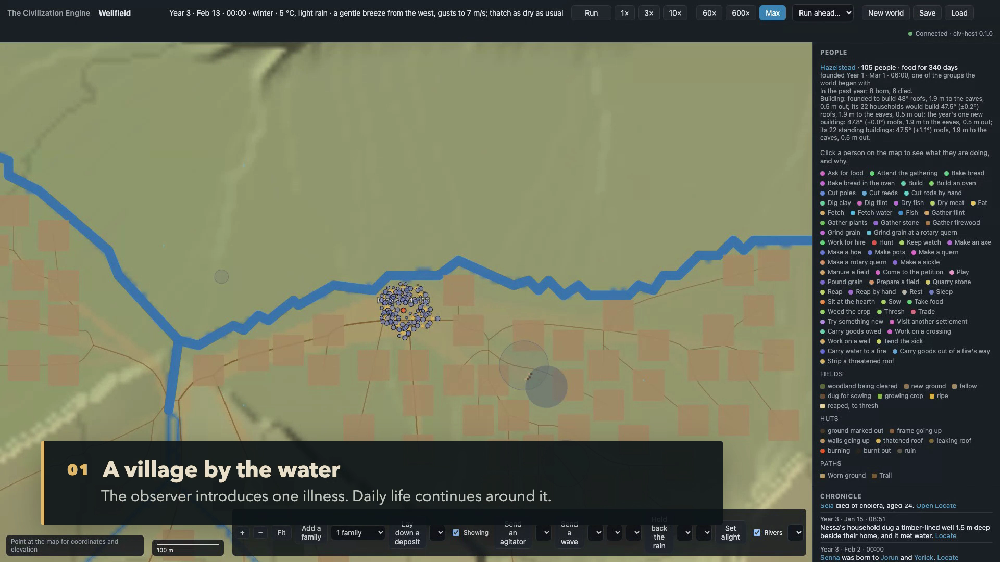
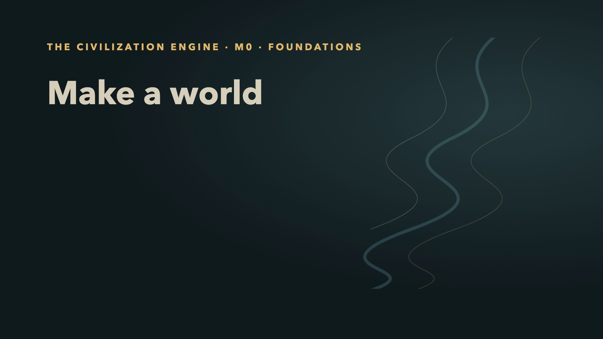
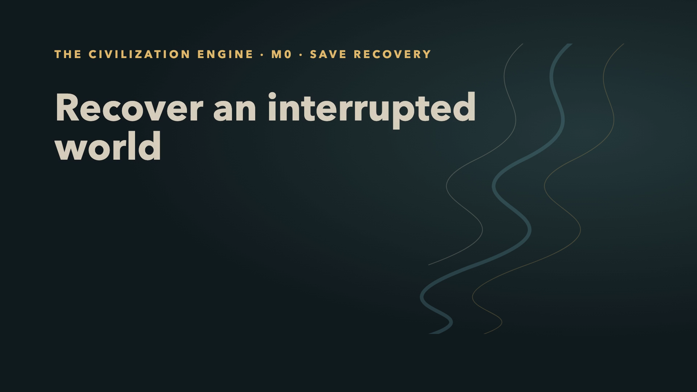
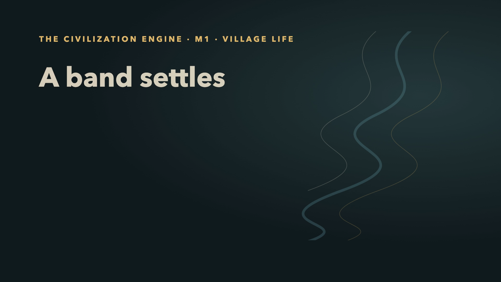
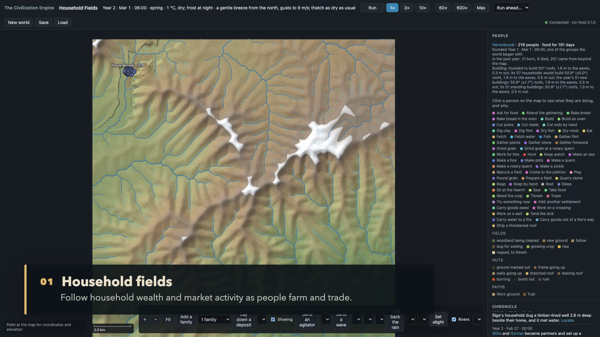
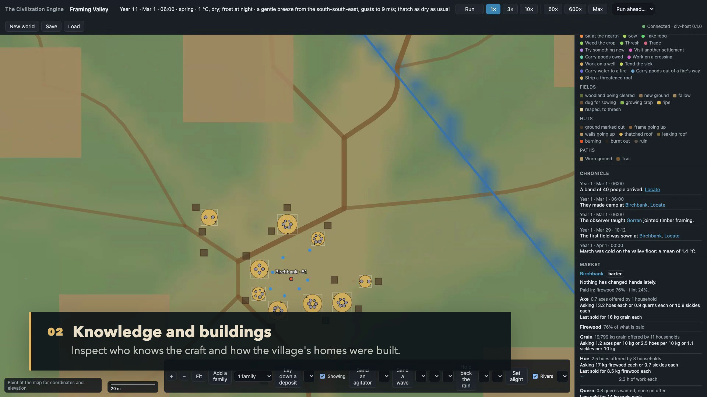
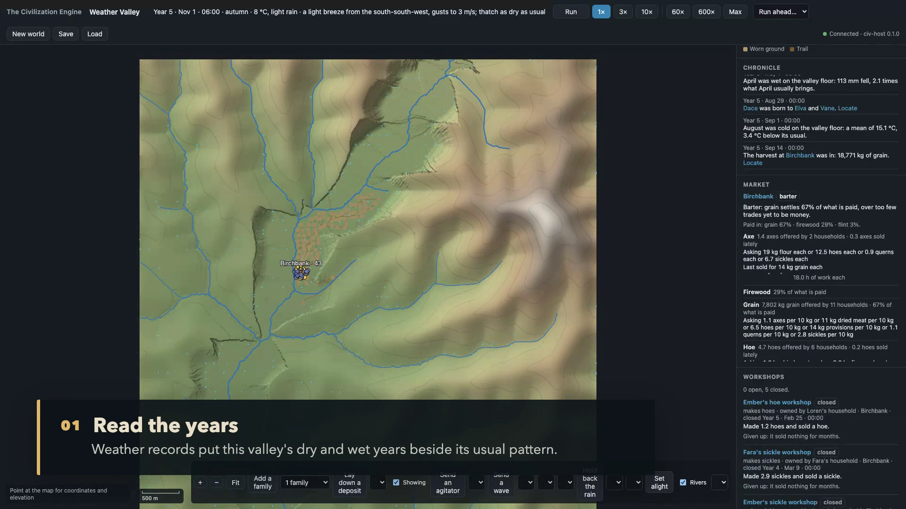
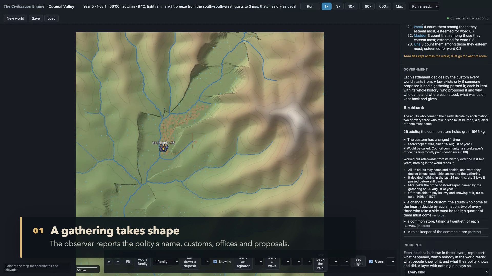
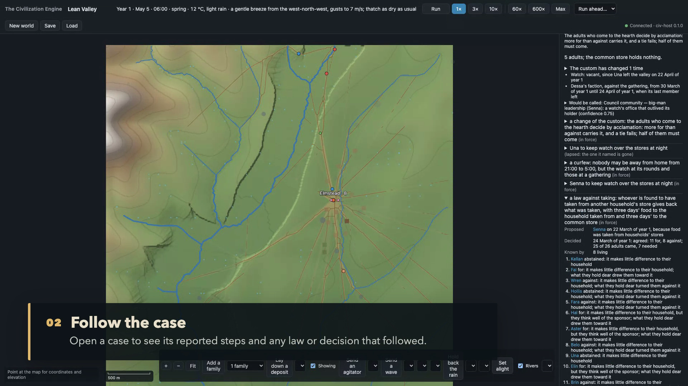
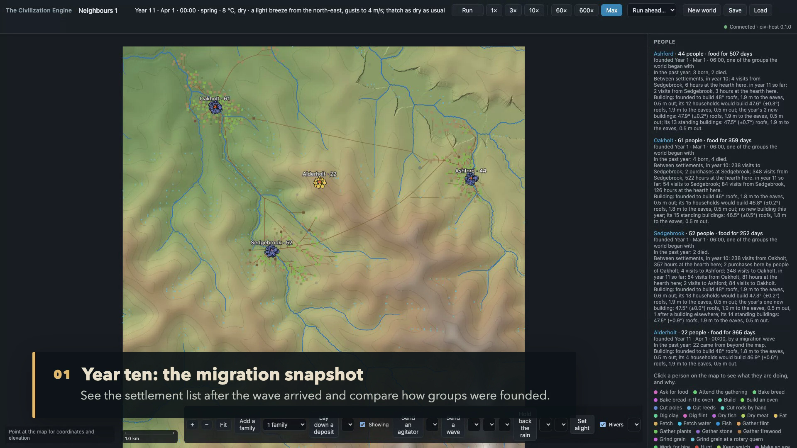

# TCE Demo Gallery

This is the guide to the project's demonstrations across milestones. The watchable videos have
opening titles and on-screen explanations; their source captures are kept for production history.
A screenshot or demo run shows one build and one world, not an outcome every world will produce.

## Newest available demo: M6a, water and sickness

The latest complete milestone demo starts an early-farming village, gives cholera to one person,
then follows the outbreak through the water system. In this captured run, 65 people took cholera,
55 cases came through water, 17 became ill and three died. The observer traces cases to household
wells; residents did not identify those wells as a cause, and no law named them. The observer keeps
modeled routes, residents' knowledge and the polity's response visible as separate layers. Outcomes
vary between runs.

M6b fire response and hazard repairs are in development; no completed M6b lived capture is available yet. The M6a capture remains the newest available milestone demo.

The captures below are from that live observer run. The complete version history is in the table
that follows.

<p align="center"><a href="m6a/m6a-overview.mp4"></a></p>

- [Incidents panel](m6a/m6a-incidents.png)
- [Outbreak evidence and public response](m6a/m6a-outbreak.png)
- [Water lens close-up](m6a/m6a-lens.png)
- [1080p overview with title and chapter captions](m6a/m6a-overview.mp4)
- [Recorded demo narration and observed outcome](m6a/m6a-demo.txt)
- [M6a demo runner](../web/e2e/m6a-demo.spec.ts)
- [Video production project and refresh steps](m6a/production/README.md)
- [Water, sickness and fire technical guide](../docs/development-journal/hazards-and-health.md)

M6b fire behavior is in progress, but its milestone demo is not complete yet. M6a is therefore the
newest complete, runnable milestone demonstration in this repository.

## Demos by milestone

| Milestone | Demonstration | What is available here |
| --- | --- | --- |
| M0 · Foundations | Generate a seeded valley and inspect its terrain and river network | [Watch the titled 1080p overview](m0/m0-overview.mp4)<br><a href="m0/m0-overview.mp4"></a><br>[Screenshots](../assets/m0/) |
| M0 · Save recovery | After an unclean shutdown, the observer offers its last autosave and restores the world | [Watch the titled 1080p explanation](m0/m0-recovery.mp4)<br><a href="m0/m0-recovery.mp4"></a> |
| M1 · A band settles | Follow a founding band through village growth, then see the save and reload flow | [Watch the titled 1080p overview](m1/m1-overview.mp4)<br><a href="m1/m1-overview.mp4"></a><br>[Screenshots](../assets/m1/) · [Demo runner](../web/e2e/demo.spec.ts) |
| M2 · Unreal groundwork | Portable kernel and C interface; Unreal client remains future work | [C interface guide](../docs/development-journal/persistence-and-interfaces.md#c-interface) |
| M3a · Village economy | Compare household fields and village fields in one valley | [Watch the titled 1080p overview](m3a/m3a-overview.mp4)<br><a href="m3a/m3a-overview.mp4"></a><br>[Demo captures](m3a/recording/), [demo runner](../web/e2e/m3a-demo.spec.ts) |
| M3b · Knowledge and buildings | Introduce a craft, inspect its history and see village buildings | [Titled 1080p overview](m3b/m3b-overview.mp4)<br><a href="m3b/m3b-overview.mp4"></a><br>[Screenshots and source capture](m3b/recording/), [demo runner](../web/e2e/m3b-demo.spec.ts) |
| M3c · Seasons and time | Compare seasonal records, markets and accelerated simulation | [Titled 1080p overview](m3c/m3c-overview.mp4)<br><a href="m3c/m3c-overview.mp4"></a><br>[Year-at-Max capture](m3c/recording/m3c-a-year-on.png), [demo runner](../web/e2e/m3c-demo.spec.ts) |
| M4 · Councils, law and crime | Government, public decisions and the path from incident to case | [M4a government overview](m4a/m4a-overview.mp4)<br><a href="m4a/m4a-overview.mp4"></a><br>[M4a runner](../web/e2e/m4a-demo.spec.ts)<br>[M4b incidents overview](m4b/m4b-overview.mp4)<br><a href="m4b/m4b-overview.mp4"></a><br>[M4b runner](../web/e2e/m4b-demo.spec.ts) |
| M5a · Neighboring settlements | Founding groups, migration and movement across settlements | [Titled 1080p overview](m5a/m5a-overview.mp4)<br><a href="m5a/m5a-overview.mp4"></a><br>[Demo captures](m5a/recording/), [demo runner](../web/e2e/m5a-demo.spec.ts) |
| M5b · Trade and diffusion | The original connected-village demo no longer qualifies after corrected river routing separated its villages; a replacement lived demo remains open | [Development record](../docs/development-journal/development-history.md#2026-10-10--m5b-slice-as-the-m5b-demo) |
| M5c · Relations and public works | Agreements and crossings are covered by lived runs and test worlds; no standalone observer recording is committed | [Project plan evidence](../PROJECT_PLAN.md#9-decisions-log) |
| M6a · Water and sickness | Cholera, water sources, resident knowledge and the Water lens | [Watch the titled 1080p overview](m6a/m6a-overview.mp4) · [screenshots and run log](m6a/) · [demo runner](../web/e2e/m6a-demo.spec.ts) |
| M6b · Fire, masonry and floods | Fire behavior is in progress; the milestone demonstration is planned | [Current status and evidence](../PROJECT_PLAN.md#7-milestones) |
| M6c · War and conquest | Planned | [Current status](../PROJECT_PLAN.md#7-milestones) |

Some milestone demo scripts intentionally explore emergent outcomes and can take a long time. They
run only when requested with `TCE_DEMO=1`; they may try more than one world and report what
happened instead of forcing a scripted result. For milestone scope and known limitations, use the
[project plan](../PROJECT_PLAN.md). For the complete chronological record, see the
[development journal](../docs/development-journal/README.md).

## Refreshing the latest demo

When the current README status or feature showcase is updated, update this gallery and the README's
featured images together. Use the newest completed demo that has a real observer run. Save fresh
captures under `demos/<milestone>/`, keep prior milestone media and links in this gallery, and label
concept art separately from screenshots. Do not describe an unfinished milestone's design as a
demo.

For example, from `web/`, after building the web app and `civ-host`, capture M6a with:

```sh
mkdir -p ../demos/m6a
TCE_DEMO=1 TCE_DEMO_VIDEO=1 TCE_SHOTS_DIR=../demos/m6a npm run test:e2e -- m6a-demo.spec.ts
```

The demo runner writes the raw 1920×1080 observer recording, screenshots and text log directly to
`demos/m6a/`. Preview and render the title-and-caption version with the [M6a video project](m6a/production/README.md).

M6b is in progress: masonry and flood/storm mechanics are implemented, while the fire-to-building-rule demo remains planned. M6a is still the newest completed lived demo.
