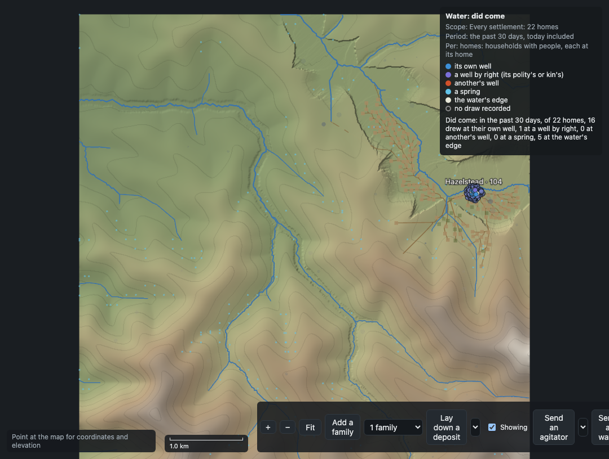
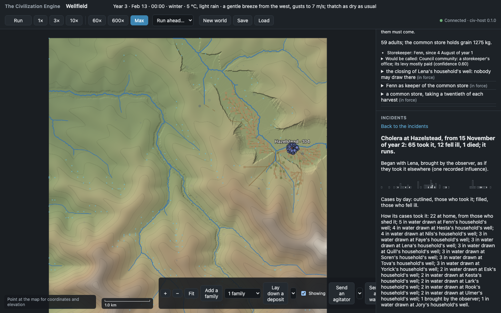

# TCE Demo Gallery

This is the guide to the project's demonstrations across milestones. It separates playable
observer demos and runnable demo scripts from committed screenshots and recordings. A screenshot
or demo run shows one build and one world; it is not evidence that every world produces the same
outcome.

## Newest available demo: M6a, water and sickness

The latest complete milestone demo starts an early-farming village, gives cholera to one person,
then follows the outbreak through the water system. In this captured run, 65 people took cholera,
42 cases came through water, 12 became ill and one died. Residents suspected Lena's household well,
and the gathering voted to close it; five water cases in the recorded route came from that well.
The observer keeps the modeled route evidence, residents' beliefs and the polity's decision visible
as separate layers. Outcomes vary between runs.

The captures below are from that live observer run. The complete version history is in the table
that follows.





- [Incidents panel](m6a/m6a-incidents.png)
- [Recorded demo narration and observed outcome](m6a/m6a-demo.txt)
- [M6a demo runner](../web/e2e/m6a-demo.spec.ts)
- [Water, sickness and fire technical guide](../docs/development-journal/hazards-and-health.md)

M6b fire behavior is in progress, but its milestone demo is not complete yet. M6a is therefore the
newest complete, runnable milestone demonstration in this repository.

## Demos by milestone

| Milestone | Demonstration | What is available here |
| --- | --- | --- |
| M0 · Foundations | Create and inspect a generated world; save and recover it | [Demo video](../assets/m0/m0-demo.webm), [recovery video](../assets/m0/m0-recovery.webm), and [screenshots](../assets/m0/) |
| M1 · A band settles | Follow a village over ten years, then save and reload | [Demo video](../assets/m1/m1-demo.webm), [screenshots](../assets/m1/), and [demo runner](../web/e2e/demo.spec.ts) |
| M2 · Unreal groundwork | Portable kernel and C interface; Unreal client remains future work | [C interface guide](../docs/development-journal/persistence-and-interfaces.md#c-interface) |
| M3a · Village economy | Economy and household wealth in the observer | [Screenshots](../assets/m3a/), [demo runner](../web/e2e/m3a-demo.spec.ts) |
| M3b · Knowledge and buildings | Knowledge and a lived village | [Village screenshot](../assets/m3b/m3b-village.jpg), [knowledge panel](../assets/m3b/m3b-knowledge.jpg), [demo runner](../web/e2e/m3b-demo.spec.ts) |
| M3c · Seasons and time | Dry and wet years, harvest and weather panels | [Demo runner](../web/e2e/m3c-demo.spec.ts) |
| M4 · Councils, law and crime | Government, law, cases and political histories | [M4 demo runner](../web/e2e/m4-demo.spec.ts), [M4a](../web/e2e/m4a-demo.spec.ts), and [M4b](../web/e2e/m4b-demo.spec.ts) |
| M5a · Neighboring settlements | Founding groups, migration and movement across settlements | [Demo runner](../web/e2e/m5a-demo.spec.ts) |
| M5b · Trade and diffusion | The original connected-village demo no longer qualifies after corrected river routing separated its villages; a replacement lived demo remains open | [Development record](../docs/development-journal/development-history.md#2026-10-10--m5b-slice-as-the-m5b-demo) |
| M5c · Relations and public works | Agreements and crossings are covered by lived runs and test worlds; no standalone observer recording is committed | [Project plan evidence](../PROJECT_PLAN.md#9-decisions-log) |
| M6a · Water and sickness | Cholera, water sources, resident knowledge and the Water lens | [Screenshots and run log](m6a/), [demo runner](../web/e2e/m6a-demo.spec.ts) |
| M6b · Fire, masonry and floods | Fire behavior is in progress; the milestone demonstration is planned | [Current status and evidence](../PROJECT_PLAN.md#7-milestones) |
| M6c · War and conquest | Planned | [Current status](../PROJECT_PLAN.md#7-milestones) |

Some milestone demo scripts intentionally explore emergent outcomes and can take a long time. They
run only when requested with `TCE_DEMO=1`; they may try more than one world and report what
happened instead of forcing a scripted result. For milestone scope and known limitations, use the
[project plan](../PROJECT_PLAN.md). For the complete chronological record, see the
[development journal](../docs/development-journal/README.md).

## Refreshing the latest demo

When the current README status or feature showcase is updated, update this gallery and the README's
featured images together. Use the newest completed demo that has a real observer run. Save fresh
captures under `demos/<milestone>/`, keep prior milestone media and links in this gallery, and label
concept art separately from screenshots. Do not describe an unfinished milestone's design as a
demo.

For example, from `web/`, after building the web app and `civ-host`, capture M6a with:

```sh
mkdir -p ../demos/m6a
TCE_DEMO=1 TCE_DEMO_VIDEO=1 TCE_SHOTS_DIR=../demos/m6a npm run test:e2e -- m6a-demo.spec.ts
```

Playwright keeps its video under `web/test-results/`; copy the successful run's `video.webm` into
`demos/m6a/` if publishing the recording. The test's screenshots and text log are written directly
to the gallery folder.
